<p align="center">
  
</p>

# 💧 Awesome Smart Water Utility Leak Detection Software

<p align="center">
  <a href="https://github.com/ishandutta2007/Awesome-Awesome-Awesome"></a>
  <a href="https://discord.gg/jc4xtF58Ve"></a>
  <a href="https://github.com/ishandutta2007/Awesome-Smart-Water-Utility-Leak-Detection-Software/stargazers"></a>
  <a href="https://github.com/ishandutta2007/Awesome-Smart-Water-Utility-Leak-Detection-Software/network/members"></a>
  <a href="https://github.com/ishandutta2007/Awesome-Smart-Water-Utility-Leak-Detection-Software/pulls"></a>
  <a href="https://opensource.org/licenses/MIT"></a>
  <a href="https://github.com/ishandutta2007"></a>
</p>

---

## 📖 Overview & SEO Summary

A curated directory of top **SaaS intelligence platforms**, **hydraulic digital twin engines**, **acoustic IoT sensors**, and **open-source software** powering modern municipal and industrial **Smart Water Utility Leak Detection**. 

Water distribution networks lose an estimated 126 billion cubic meters of potable water annually—costing utilities upwards of $39 billion in non-revenue water (NRW) losses. The solutions cataloged here leverage **acoustic transient listening**, **district metered area (DMA) hydraulic analytics**, **satellite Synthetic Aperture Radar (SAR)**, **advanced metering infrastructure (AMI)**, and **machine learning anomaly detection** to pinpoint pipe bursts, incipient pinholes, and infrastructure fatigue before catastrophic washouts occur.

---

## 📑 Table of Contents

- [🌐 Sector Overview & Market Dynamics](#-sector-overview--market-dynamics)
- [🏢 Enterprise & SaaS Platforms](#-enterprise--saas-platforms)
- [💻 Open-Source GitHub Projects](#-open-source-github-projects)
- [🔬 Academic & Specialized Research Frameworks](#-academic--specialized-research-frameworks)
- [🏗️ Reference Architecture: Building a Self-Hosted Leak Detection Stack](#️-reference-architecture-building-a-self-hosted-leak-detection-stack)
- [🤝 How to Contribute](#-how-to-contribute)
- [⭐ Star History](#-star-history)
- [💖 Support & Community](#-support--community)
- [⚖️ Disclaimer & Compliance](#️-disclaimer--compliance)

---

## 🌐 Sector Overview & Market Dynamics

The global smart water management and leak detection systems market is estimated at **$5.55 billion to $19.47 billion in 2026** and is projected to expand toward **$36 billion to $40+ billion by 2030**, advancing at a compound annual growth rate (**CAGR of 11.2% to 15.3%**). Accelerated capital expenditure across North America, Europe, and Asia-Pacific is driven by aging water distribution mains, mandatory non-revenue water (NRW) reduction legislation, strict climate resilience mandates, and insurance requirements for automated leak mitigations.

The sector is **moderately fragmented**: established multi-billion-dollar infrastructure conglomerates (*Autodesk*, *Xylem*, *Badger Meter*, *Kamstrup*) command foundational metering, SCADA, and utility-wide enterprise deployments, while high-growth deep-tech scale-ups (*Asterra*, *SewerAI*, *WINT*, *FIDO Tech*, *KETOS*) dominate specialized technological vectors such as satellite L-band SAR, computer-vision pipe scoring, and acoustic AI neural networks. Consequently, the industry exhibits active strategic consolidation, corporate venture acquisitions (e.g., Autodesk acquiring Innovyze for $1.0B; JMI Equity's $342M buyout of SewerAI), and an accelerating shift toward hybrid architectures that unite physical edge loggers with open API cloud analytics.

---

## 🏢 Enterprise & SaaS Platforms

The table below compiles leading commercial platforms engineered for municipal distribution networks, commercial real estate, and industrial plants. 

> [!NOTE]
> Entries are sorted in **descending order by company scale** (Market Capitalization / Enterprise Valuation / Disclosed Annual Revenue).

| 🏢 Platform / Provider | 📊 Company Size (Valuation / Revenue) | 🏷️ Specific Starting Price | 🆓 Free Tier / Trial Limits | 🔍 Core Detection Capabilities & Sensor Modality |
| :--- | :--- | :--- | :--- | :--- |
| **[Autodesk (Innovyze InfoWorks)](https://www.innovyze.com/)** | **~$50B Market Cap**<br>($6.1B+ Annual Revenue) | **$5,500 / year**<br>(InfoWorks ICM Sewer seat; WS Pro models start ~$9,500/yr) | **30-day fully functional trial** for Info360 / InfoWorks suites; permanent free read-only InfoWorks ICM Viewer | Cloud digital twin modeling (Info360 Asset/WS Pro), real-time hydraulic pressure transient analysis, hydraulic leakage simulation. |
| **[Xylem Vue](https://www.xylem.com/)** | **~$24B Market Cap**<br>($9.04B Annual Revenue) | **$20,000 / year**<br>(Sourcewell Contract #091724-XYLE baseline utility analytics module) | **60-day interactive utility pilot** with sample District Metered Area (DMA) sensor telemetry | Enterprise AMI/SCADA integration, acoustic fiber-optic pipeline monitoring (Pure Technologies), automated DMA mass balance. |
| **[Badger Meter (BEACON AMA)](https://www.badgermeter.com/)** | **~$3.8B Market Cap**<br>($916.7M Annual Revenue) | **$0.73 – $0.89 / month**<br>(Per ORION cellular endpoint subscription; hardware ~$100/unit) | **Free forever EyeOnWater consumer portal**; 30-day utility sandbox pilot account with up to 25 sample endpoints | High-resolution AMI metering, continuous minimum night flow (MNF) analysis, automated consumer leak flags. |
| **[Kamstrup (READy Suite)](https://www.kamstrup.com/)** | **$510M Annual Revenue**<br>(DKK 3.5B / EU metering leader) | **€99.00 / year**<br>(READy Manager tier up to 100 metering points; €169/yr up to 250 points; €950/yr for 5,000) | **Free evaluation download** of READy Manager PC software suite with bundled synthetic meter dataset | Integrated ultrasonic acoustic listening (flowIQ 2200), smart acoustic leak detection (ALD), wireless M-Bus/drive-by telemetry. |
| **[SewerAI (AutoCode & Pioneer)](https://sewerai.com/)** | **$342M Valuation**<br>($22M+ Est. ARR / 2026 buyout) | **$0.30 / linear foot**<br>(AutoCode AI defect inspection; 3x3 municipal pilot at $14,000 for 3 months) | **Free Preliminary Rehab Plan** (upload sample CCTV footage for free AI defect coding & risk report); 14-day sandbox demo | Computer-vision AI defect detection for CCTV/manhole inspections, infiltration & inflow (I&I) leak discovery. |
| **[WINT Water Intelligence](https://wint.ai/)** | **~$250M Valuation**<br>($100M total funding; $19M ARR) | **$350 – $650 / month**<br>(Per monitored branch/junction including IoT edge compute and valve unit) | **30-day site risk assessment pilot** with 1 demo shutoff valve and real-time incident monitoring dashboard | High-frequency flow pattern AI, sub-second burst detection, automated motorized emergency water shutoff for commercial sites. |
| **[KETOS (WAVE & SHIELD)](https://ketos.co/)** | **~$75M Valuation**<br>($44.8M funding; $12M ARR) | **$1,250 / month / node**<br>(Water-as-a-Service model with $0 upfront CapEx; includes hardware maintenance) | **30-day proof-of-concept pilot** with 1 active monitoring node and up to 500 automated parameter tests | Automated water quality and flow telemetry, autonomous leak and pressure anomaly tracking, multi-parameter toxicant testing. |
| **[FIDO Tech (FIDO AI)](https://fidotech.com/)** | **~$40M Valuation**<br>($9.5M+ venture funding; $6M ARR) | **$4,500 / year**<br>(Baseline FIDO AI Leak Locate cloud tier; acoustic Bug hardware ~$150/sensor) | **30-day evaluation pilot kit** including 10 FIDO acoustic Bug sensors and automated leak-sizing AI report | Neural network acoustic analysis, AI that pinpoints and calculates physical leak size (volume) directly from noise signatures. |
| **[ASTERRA (Utilis)](https://asterra.io/)** | **~$30M Valuation**<br>($6M Series A; $24M-$35M ARR) | **$32,500 / survey**<br>(Per municipal satellite flyover/scan covering up to 500 miles of mains) | **Free preliminary satellite feasibility assessment** with 1 sample Point of Interest (POI) radar density heat map | Synthetic Aperture Radar (SAR) L-band satellite imagery, underground soil moisture analysis detecting treated drinking water leaks from orbit. |
| **[Pluto AI](https://pluto.ai/)** | **~$12M Valuation**<br>($2.1M seed; $2.5M Est. ARR) | **$50,000 / year**<br>(Starting Annual Contract Value per treatment plant / pumping network) | **30-day pilot deployment** with integration for up to 5 SCADA telemetry time-series tags | Deep learning for water/wastewater pumps, pressure transient analysis, proactive equipment degradation and leakage alerts. |

---

## 💻 Open-Source GitHub Projects

Explore battle-tested open-source libraries, hydraulic simulation engines, SCADA packages, and IoT edge firmware for water network monitoring.

> [!TIP]
> Repositories are sorted in **descending order by GitHub Stars_Count**. Click the Stars_Badge beside any project to view its stargazer community.

- **[Scada-LTS](https://github.com/SCADA-LTS/Scada-LTS)** [](https://github.com/SCADA-LTS/Scada-LTS/stargazers) — Enterprise-grade web-based SCADA platform with zero licensing fees on tags, users, or dashboards. Supports OPC UA, Modbus TCP/RTU, BACnet/IP, MQTT, DNP3, and IEC 60870-5 for water utility telemetry, real-time alarm handling, and automated pump/valve control.
- **[WNTR (Water Network Tool for Resilience)](https://github.com/USEPA/WNTR)** [](https://github.com/USEPA/WNTR/stargazers) — Python package developed by Sandia National Laboratories and the U.S. EPA. Integrates with EPANET to simulate pipe leaks, hydraulic stress, pressure-dependent demand, contamination incidents, sensor placement optimization, and natural disaster recovery scenarios.
- **[EPANET Engine](https://github.com/OpenWaterAnalytics/EPANET)** [](https://github.com/OpenWaterAnalytics/EPANET/stargazers) — The gold standard computational engine for hydraulic and water quality modeling in pressurized distribution networks. Simulates friction headloss, pipe bursts, and emitter-based pressure leakage. Maintained by Open Water Analytics under the MIT license.
- **[USEPA EPANET 2.2](https://github.com/USEPA/EPANET2.2)** [](https://github.com/USEPA/EPANET2.2/stargazers) — Official United States Environmental Protection Agency release repository for the EPANET hydraulic simulator, featuring pressure-dependent demands (PDD) and advanced water age/chlorine decay calculations.
- **[epanet-js](https://github.com/epanet-js/epanet-js)** [](https://github.com/epanet-js/epanet-js/stargazers) — Full WebAssembly compiled port of the OWA-EPANET 2.2 engine that runs natively in modern web browsers and Node.js without backend compilation or binary dependencies.
- **[epanet-js-toolkit](https://github.com/epanet-js/epanet-js-toolkit)** [](https://github.com/epanet-js/epanet-js-toolkit/stargazers) — Pure JavaScript wrapper library over the EPANET C-toolkit API, enabling full programmatic node editing, pipe roughness modification, dynamic leak simulation, and results visualization.
- **[Giswater QGIS Plugin](https://github.com/giswater/plugin)** [](https://github.com/giswater/plugin/stargazers) — QGIS open-source plugin connecting spatial GIS layers with PostgreSQL/PostGIS, EPANET, and EPA-SWMM. Powers geospatial water network inventories, DMA zoning, and district leakage isolation.
- **[EPyT (EPANET-Python Toolkit)](https://github.com/OpenWaterAnalytics/EPyT)** [](https://github.com/OpenWaterAnalytics/EPyT/stargazers) — High-level Python interface for smart water distribution network simulation, cyber-physical water security research, sensor placement algorithms, and leak localization benchmarking.
- **[LeakDB](https://github.com/KIOS-Research/LeakDB)** [](https://github.com/KIOS-Research/LeakDB/stargazers) — Realistic benchmark dataset for leakage diagnosis in drinking water networks developed by KIOS CoE and University of Cyprus. Contains thousands of simulated pipe breaks, incipient cracks, sensor noise profiles, and scoring scripts.
- **[WaterModels.jl](https://github.com/lanl-ansi/WaterModels.jl)** [](https://github.com/lanl-ansi/WaterModels.jl/stargazers) — Los Alamos National Laboratory Julia/JuMP optimization framework for steady-state and transient physics-based water distribution optimization and flow control.
- **[EPyT-Flow](https://github.com/WaterFutures/EPyT-Flow)** [](https://github.com/WaterFutures/EPyT-Flow/stargazers) — Python package by the Water Futures team engineered for generating continuous hydraulic and water quality benchmark time series, automated leak injection, sensor failures, and burst scenarios.
- **[OOPNET](https://github.com/oopnet/oopnet)** [](https://github.com/oopnet/oopnet/stargazers) — Object-oriented Python library that reads and writes EPANET `.inp` files as native Python objects, seamlessly bridging hydraulic models with Pandas, NumPy, and SciPy for data science workflows.
- **[viswaternet](https://github.com/tylertrimble/viswaternet)** [](https://github.com/tylertrimble/viswaternet/stargazers) — Specialized Python plotting package built on Matplotlib and NetworkX to generate high-quality visual heatmaps of pressure anomalies, pipe flows, and leak locations in water networks.
- **[ESPHome Water Leak Detector](https://github.com/mrahmadt/ESPHome-Water-Leak-Detector)** [](https://github.com/mrahmadt/ESPHome-Water-Leak-Detector/stargazers) — DIY smart water flow monitor utilizing ESPHome and YF-B10-S pulse meters. Detects continuous micro-leaks, running toilets, and faulty valves with Home Assistant MQTT alerts.
- **[Whole-House Water Leak Controller](https://github.com/heyitsyang/Whole-House-Water-Leak-Controller)** [](https://github.com/heyitsyang/Whole-House-Water-Leak-Controller/stargazers) — ESP32-based multi-sensor controller with motorized ball valve shutoff logic, MQTT telemetry, and configurable time-of-flight pressure drop thresholds.
- **[Smart Water Leak Detection](https://github.com/Sukrut10k/Smart-Water-Leak-Detection)** [](https://github.com/Sukrut10k/Smart-Water-Leak-Detection/stargazers) — AI machine learning pipeline featuring Random Forest, SVM, and interactive Streamlit GIS mapping for classifying pipe bursts based on multi-sensor telemetry.
- **[WIA-SOC-008 Water Supply Standard](https://github.com/WIA-Official/wia-standards-public)** [](https://github.com/WIA-Official/wia-standards-public/stargazers) — Public open architecture specifications for smart water grids, defining JSON-LD telemetry schemas, acoustic sensor accuracy criteria (97%+ target), and SCADA gateway protocols.
- **[pyanglianwater](https://github.com/pantherale0/pyanglianwater)** [](https://github.com/pantherale0/pyanglianwater/stargazers) — Python API client designed for extracting smart meter water consumption data directly from Anglian Water's consumer endpoints for automated leakage monitoring.

---

## 🔬 Academic & Specialized Research Frameworks

Notable peer-reviewed and specialized research implementations offering open algorithms for water infrastructure intelligence:

- **[SIAM (Sensor Identification & Anomaly Monitoring)](https://www.sciencedirect.com/science/article/pii/S2665963826000321)** — Topology-agnostic framework detecting pipe bursts and incipient leaks via sensor time-series whitening transformations. Validated on the L-Town benchmark with 9 out of 12 active leaks pinpointed without prior network geometry.
- **[STAC CDSE Leak Hunter](https://zenodo.org/records/18599546)** — Open Copernicus Data Space Ecosystem (CDSE) satellite pipeline utilizing Sentinel-2 NDMI (Normalized Difference Moisture Index) and ERA5-Land weather verification to track underground soil saturation anomalies from orbit.
- **[AquOculus](https://latamt.ieeer9.org/index.php/transactions/article/view/10125)** — Low-cost optoelectronic pulse counter built around the ESP32 that retrofits to analog mechanical utility meters without magnetic couplers for district telemetry.
- **[X-WHAT Model](https://link.springer.com/article/10.1007/s11269-026-04817-7)** — Open-source optimization engine for looped municipal distribution designs, solving the Water Flow Problem (WFP) with an accessible browser WebGUI.
- **[Campus LoRaWAN Water Monitor](https://indico.ufla.br/event/2/contributions/754/)** — Open-source campus telemetry stack pairing SAGATECH pulse meters with LoRaWAN ChirpStack v4, MySQL, and Grafana dashboards, maintaining ±0.5% metering accuracy.

---

## 🏗️ Reference Architecture: Building a Self-Hosted Leak Detection Stack

For municipalities, research institutes, or utility operators aiming to build an open, self-hosted smart water stack without recurring per-sensor SaaS lock-in:

```
┌────────────────────────────────────────────────────────────────────────┐
│                        PHYSICAL TELEMETRY LAYER                         │
│  [Ultrasonic Meters]   [Acoustic Loggers]   [Pressure Transducers]     │
│           │                    │                     │                 │
│      LoRaWAN / NB-IoT        M-Bus               Modbus / 4-20mA       │
└───────────────────────────────────┬────────────────────────────────────┘
                                    │
                                    ▼
┌────────────────────────────────────────────────────────────────────────┐
│                       INGESTION & SCADA GATEWAY                         │
│   • SCADA-LTS (OPC UA / Modbus / MQTT Telemetry Ingestion)             │
│   • ChirpStack (LoRaWAN Network Server & Packet Routing)               │
└───────────────────────────────────┬────────────────────────────────────┘
                                    │
                                    ▼
┌────────────────────────────────────────────────────────────────────────┐
│                     HYDRAULIC & ANALYTIC ENGINE                         │
│   • OpenWaterAnalytics/EPANET & USEPA/WNTR (Hydraulic Simulation)      │
│   • EPyT-Flow (Synthetic Anomaly Injection & Sensor Calibration)       │
│   • SIAM Whitening Transform (Topology-free Burst Detection)           │
└───────────────────────────────────┬────────────────────────────────────┘
                                    │
                                    ▼
┌────────────────────────────────────────────────────────────────────────┐
│                      GIS & OPERATIONAL DASHBOARDS                       │
│   • Giswater + QGIS (Spatial Network Asset & Valve Mapping)            │
│   • Grafana / viswaternet (Pressure Gradient Heatmaps & Alarms)        │
└────────────────────────────────────────────────────────────────────────┘
```

---

## 🤝 How to Contribute

Contributions to expand and update this ecosystem guide are warmly encouraged!

1. 🍴 **Fork the Repository**: Clone your fork locally.
2. 🌿 **Create a Branch**: `git checkout -b feature/add-new-leak-tool`.
3. 📝 **Add Your Entry**: Ensure SaaS entries include verified starting prices and free trial durations, or open-source entries include an active GitHub repository link.
4. 🧪 **Check Guidelines**: Adhere to alphabetical or metrics-sorted tables and factual descriptions.
5. 🚀 **Submit a Pull Request**: Detail the value and licensing of the submitted tool.

---

## ⭐ Star History

[](https://star-history.dera.page/#ishandutta2007/Awesome-Smart-Water-Utility-Leak-Detection-Software&type=date&legend=top-left)

---

## 💖 Support & Community

Thank you for visiting and supporting the **Awesome Smart Water Utility Leak Detection Software** ecosystem! 

If this curated repository assists your municipal research, engineering decisions, or software development:
- ⭐ **Star this repository** to improve discoverability for other water professionals.
- 🍴 **Fork the repo** to benchmark your own utility configurations or track local deployments.
- 📢 **Share this resource** on LinkedIn, Twitter, or engineering forums.

If you appreciate the curation and would like to support ongoing maintenance:

<p align="center">
  <a href="https://github.com/sponsors/ishandutta2007">
    
  </a>
</p>

---

## ⚖️ Disclaimer & Compliance

- This repository is a **community-curated index** provided for educational and informational purposes. Mention of specific vendors or products does not constitute an official endorsement.
- Water distribution monitoring systems must adhere to local environmental protection requirements, the Safe Drinking Water Act (SDWA), and the European Drinking Water Directive (EU 2020/2184).
- Production deployments of open-source SCADA or automated shutoff valves must undergo stringent safety reviews, fail-safe testing, and cybersecurity auditing.

---

<p align="center">
  <sub>Maintained with 💙 for water utility engineers, non-revenue water managers, and IoT pioneers worldwide.</sub>
</p>
